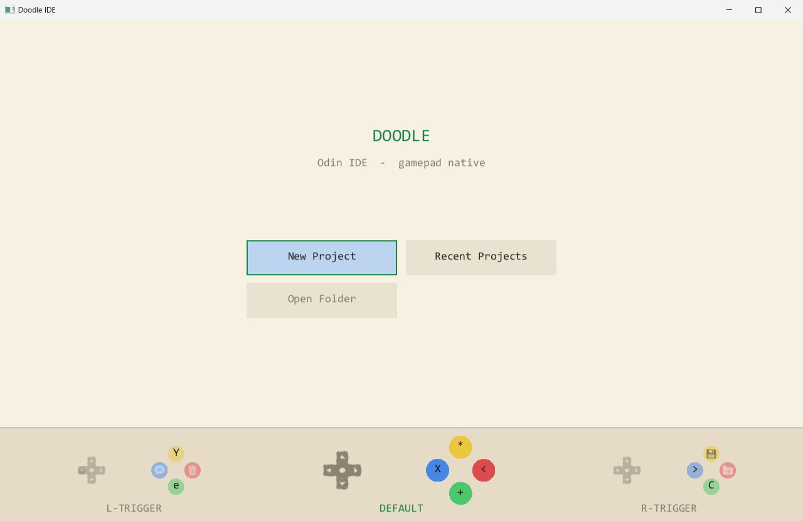

# Doodle

**A cozy little IDE for the [Odin](https://odin-lang.org) programming language, played with a gamepad.**


Doodle is an Odin editor you drive with a controller. It's written in Odin, it runs on Windows and Steam Deck

 Hold a trigger and dictate through local Whisper (no cloud) for naming variables and screaming numbers at your computer





## Running it

You need the **Odin compiler** on your `PATH`, plus a gamepad.

1. **Install Odin.** Grab a release from [odin-lang/Odin releases](https://github.com/odin-lang/Odin/releases), unzip it somewhere (for example `C:\Odin`), and add that folder to your `PATH`. On Windows you also need the MSVC build tools ("Desktop development with C++"). Check that it worked:
   ```sh
   odin version
   ```
2. **Build and run Doodle:**
   ```sh
   build.bat run                 # Windows
   ./build.sh run                # Linux / Steam Deck
   build.bat run path\to\file.odin   # open a file straight away
   ```
3. **Run the tests** (optional):
   ```sh
   build.bat test
   ```

Debug builds record every run so you can replay it or see which buttons you use most; see [`docs/TRACE.md`](docs/TRACE.md).

Need more detail (SDL2, Whisper, Steam Deck setup)? See [`docs/INSTALL.md`](docs/INSTALL.md). Curious how it's put together? See [`ARCHITECTURE.md`](ARCHITECTURE.md).

### SteamOS release builds

A manual GitHub Actions workflow builds Doodle in Valve's Steam Linux Runtime ("sniper") SDK and publishes a `doodle-steamos-<version>.tar.gz` release:

```sh
gh workflow run release-steamos.yml -f version=0.1.0   # add -f prerelease=true for a test build
gh run watch                                            # follow it
```

On the Deck, `tools/deck_install.sh [tag]` downloads a release into `~/Applications/doodle`. Without a checkout:

```sh
curl -fsSL https://raw.githubusercontent.com/MichJadams/doodle/master/tools/deck_install.sh | bash
```

## Credits

The sound effects come from Freesound under CC licenses. Full attribution is in [`assets/sounds/README.txt`](assets/sounds/README.txt).
