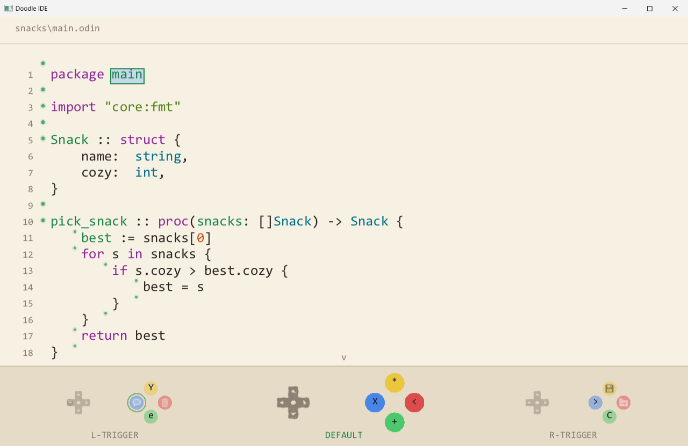
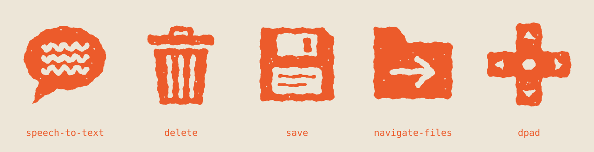

# Doodle

**A cozy little IDE for the [Odin](https://odin-lang.org) programming language, played with a gamepad.**



Doodle is an Odin editor you drive with a controller from the couch. It's written in Odin, it runs on Windows and Steam Deck, and it is full of nonsense on purpose:

- 📝 **Pencil scribble sounds** when you add code, and a **paper crumple** when you switch files
- 🎮 **Gamepad first.** You move around by code structure, and a button HUD always shows what each button does
- 🔀 **Rearrange the buttons** on the Key Layout page (main menu or IDE menu): d-pad + X/Y/A/B, with the triggers as modifiers
- 🗣️ **Talk to it.** Hold a trigger and dictate through local Whisper (no cloud)
- 🖍️ **Hand-drawn icons**, warm paper colors, syntax highlighting, and live error checking with `odin check`
- ▶️ **Run your project** (`odin run .`) without leaving the couch


## This is for fun

It's a hobby project. It is not trying to replace your real editor, it has rough edges, and some features exist only because they made me smile. So everyone please calm down. 🫖

## Running it

You need the **Odin compiler** on your `PATH`, plus a gamepad.

1. **Install Odin.** Grab a release from [odin-lang/Odin releases](https://github.com/odin-lang/Odin/releases), unzip it somewhere (for example `C:\Odin`), and add that folder to your `PATH`. On Windows you also need the MSVC build tools ("Desktop development with C++"). Check that it worked:
   ```sh
   odin version
   ```
2. **Build and run Doodle:**
   ```sh
   build.bat run                 # Windows
   ./build.sh run                # Linux / Steam Deck
   build.bat run path\to\file.odin   # open a file straight away
   ```
3. **Run the tests** (optional):
   ```sh
   build.bat test
   ```

Debug builds record every run so you can replay it or see which buttons you use most; see [`docs/TRACE.md`](docs/TRACE.md).

Need more detail (SDL2, Whisper, Steam Deck setup)? See [`docs/INSTALL.md`](docs/INSTALL.md). Curious how it's put together? See [`ARCHITECTURE.md`](ARCHITECTURE.md).



## Credits

The sound effects come from Freesound under CC licenses. Full attribution is in [`assets/sounds/README.txt`](assets/sounds/README.txt).
